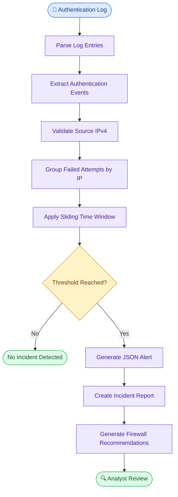
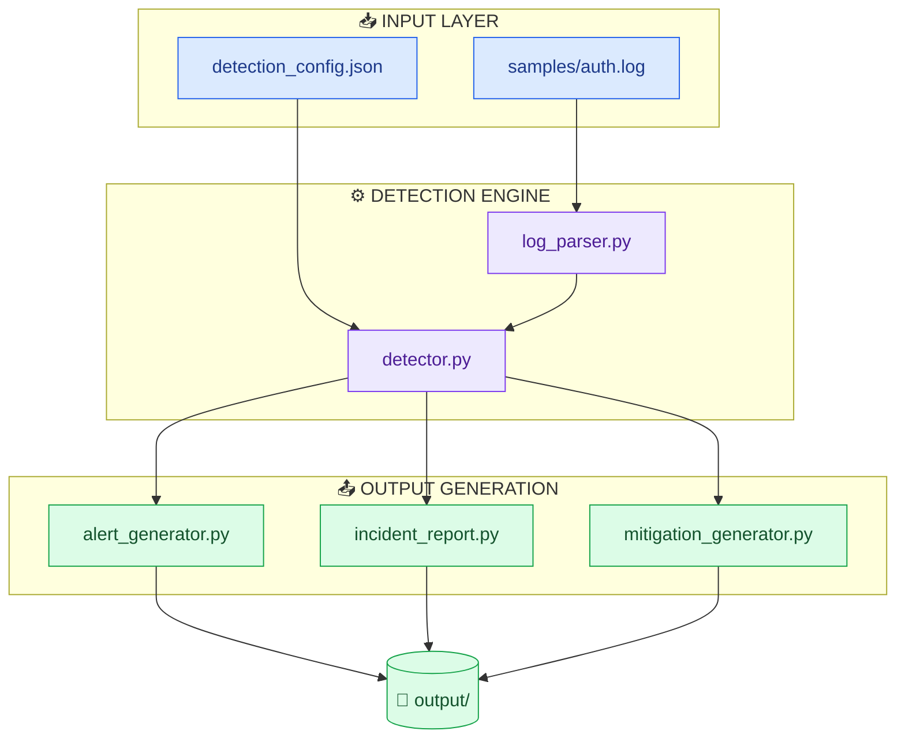
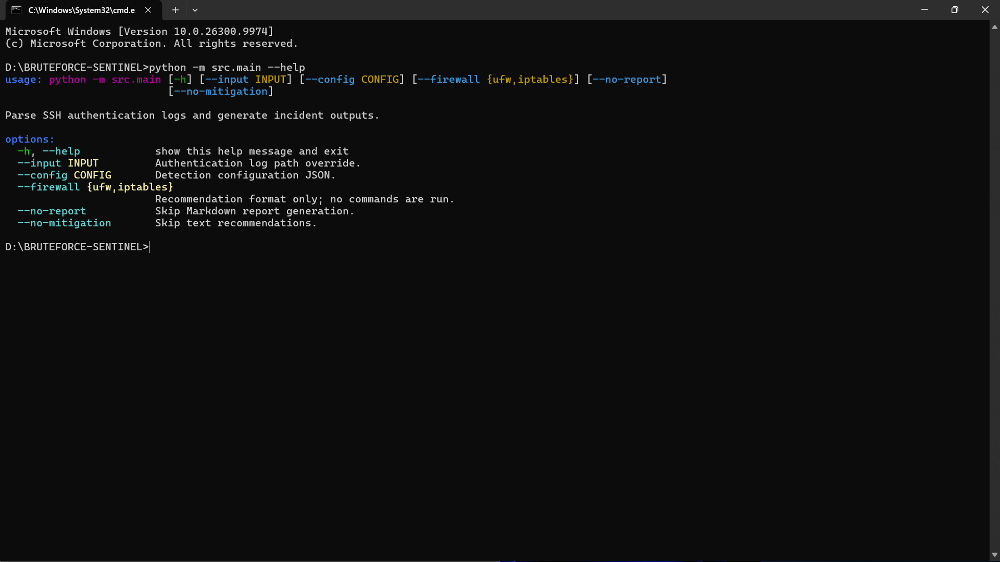
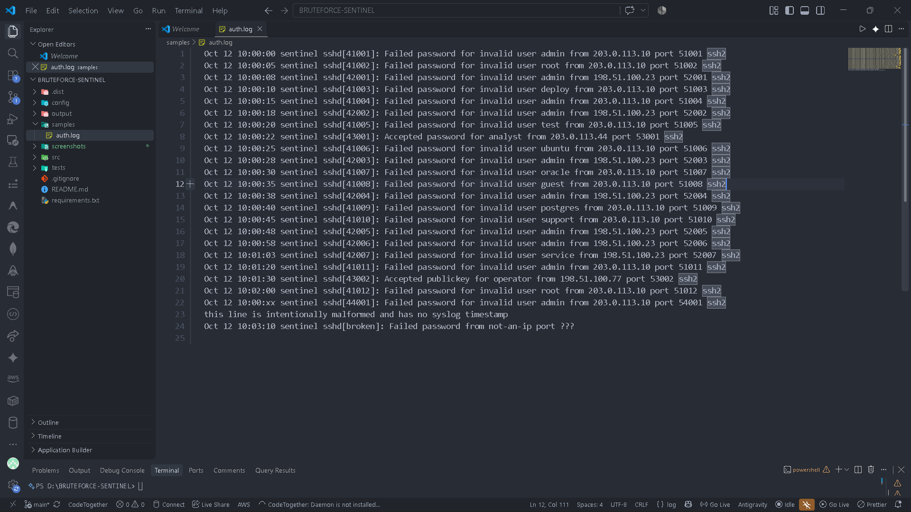
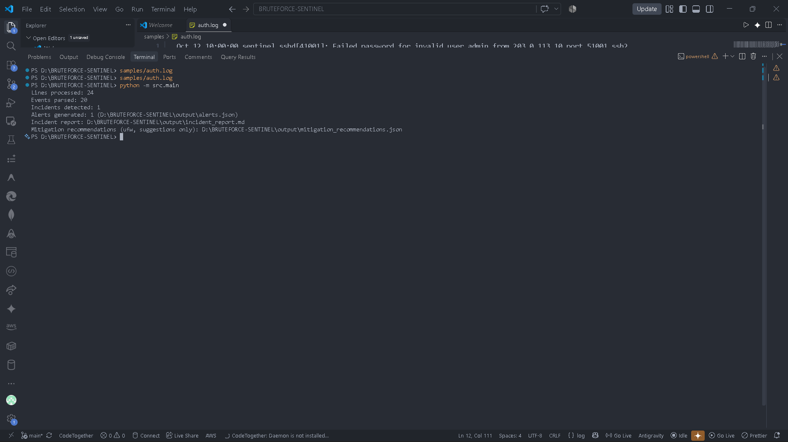
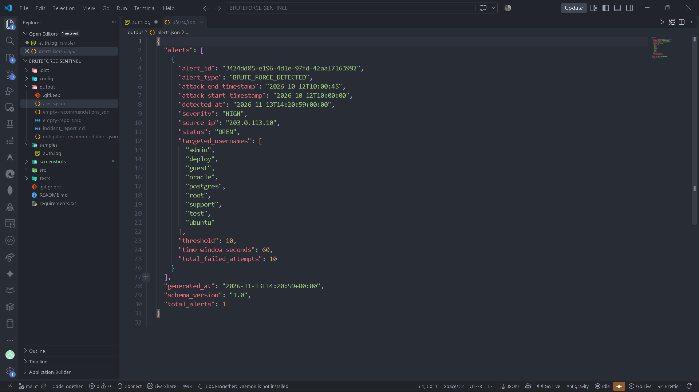
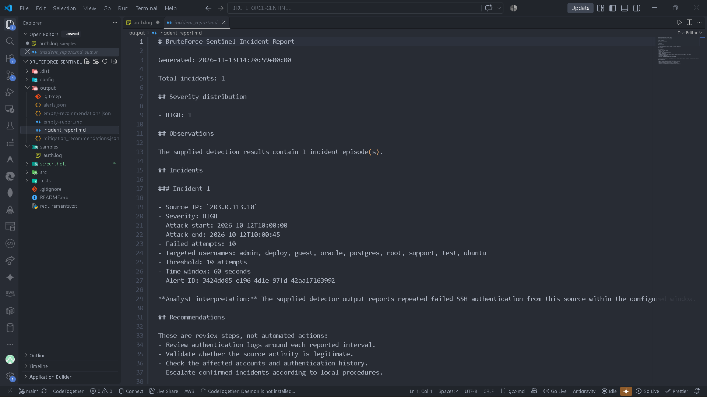
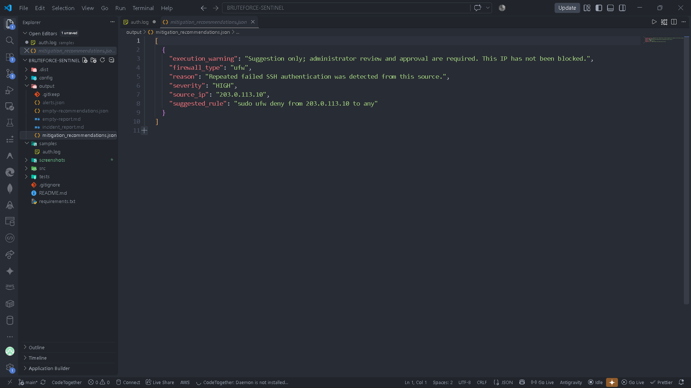

# 🔐 Week 6 — BruteForce Sentinel
### Automated Brute-Force Detection & Incident Alerting Engine

<p align="center">


</p>

<p align="center">
<strong>Python-Based Authentication Log Analysis, Brute-Force Detection & Incident Reporting</strong>
</p>

<p align="center">
GetIntern — 8-Week Practical Cybersecurity Internship | Week 6
</p>

---

## 📌 1. Project Overview

**BruteForce Sentinel** is a Python-based defensive security tool designed to analyze Linux authentication logs and identify potential SSH brute-force activity.

The engine processes authentication events, groups failed login attempts by source IP address, and applies configurable threshold-based detection within a sliding time window.

When suspicious activity meets the configured detection criteria, the system generates structured JSON alerts, an incident report, and firewall mitigation recommendations.

The project follows this defensive security workflow:

> **Ingest → Parse → Validate → Detect → Alert → Report → Recommend**

### Key Features

- Linux SSH authentication log parsing.
- Failed and successful authentication event recognition.
- IPv4 source address validation.
- Sliding time-window detection.
- Configurable failed-attempt threshold.
- Source IP-based incident correlation.
- Structured JSON alert generation.
- Markdown incident reporting.
- UFW and iptables mitigation recommendations.
- A review-only firewall ban list with both command formats.
- Command-line configuration and execution.
- Automated unit and integration tests.

---

## 🎯 2. Objectives

The primary objectives of this task were:

1. Understand brute-force authentication attacks.
2. Analyze Linux SSH authentication logs.
3. Extract and normalize authentication events using Python.
4. Detect repeated failed login attempts from the same source IP.
5. Implement sliding-window time-based correlation.
6. Configure detection thresholds and severity levels.
7. Generate structured security alerts in JSON.
8. Produce readable incident reports in Markdown.
9. Generate firewall mitigation recommendations.
10. Validate the complete workflow through automated tests.

---

## 🧠 3. What Is a Brute-Force Attack?

A **brute-force attack** is an authentication attack in which an attacker repeatedly attempts different passwords or credentials to gain unauthorized access to an account or system.

For example, repeated SSH password failures from the same source IP may indicate password guessing activity.

### Example Authentication Events

```text
Nov 13 10:00:01 ubuntu-server sshd[1001]: Failed password for root from 203.0.113.10 port 51001 ssh2
Nov 13 10:00:05 ubuntu-server sshd[1002]: Failed password for admin from 203.0.113.10 port 51002 ssh2
Nov 13 10:00:10 ubuntu-server sshd[1003]: Failed password for user from 203.0.113.10 port 51003 ssh2
```

Repeated failures from one address can be a useful detection indicator.

However, failed authentication attempts alone do not prove that an attack occurred. Alerts require investigation and additional security context.

---

## 🏗️ 4. Environment

| Component | Details |
|---|---|
| Operating System | Windows 11 for development and testing |
| Programming Language | Python 3 |
| Log Format | Linux SSH authentication logs |
| Detection Method | Threshold-based sliding time window |
| Configuration | JSON |
| Alert Format | JSON |
| Incident Report | Markdown |
| Mitigation | UFW and iptables recommendations |
| Testing | Python unittest |
| Editor | Visual Studio Code |
| Version Control | Git |
| Repository Hosting | GitHub |
| Training | GetIntern Cybersecurity Internship |
| Task | Week 6 — Automated Incident Alerting & Brute-Force Detection |

---

## 🛠️ 5. Tools & Python Modules

The project uses Python standard-library modules.

| Module | Purpose |
|---|---|
| `re` | Authentication log pattern matching |
| `datetime` | Timestamp parsing and time-window calculations |
| `json` | Configuration and structured alert generation |
| `collections` | Event grouping and aggregation |
| `ipaddress` | IPv4 address validation |
| `argparse` | Command-line argument handling |
| `uuid` | Unique alert identifiers |
| `pathlib` | File and directory management |
| `unittest` | Automated testing |

**No third-party Python packages are required.**

---

## 📁 6. Project Structure

```text
BruteForce-Sentinel/
│
├── src/
│   ├── __init__.py
│   ├── main.py
│   ├── log_parser.py
│   ├── detector.py
│   ├── alert_generator.py
│   ├── incident_report.py
│   └── mitigation_generator.py
│
├── config/
│   └── detection_config.json
│
├── samples/
│   └── auth.log
│
├── output/
│   ├── .gitkeep
│   ├── security_alert.json
│   ├── incident_report.md
│   ├── mitigation_recommendations.json
│   └── firewall_ban_list.md
│
├── tests/
│   ├── __init__.py
│   ├── test_log_parser.py
│   ├── test_detector.py
│   ├── test_alert_generator.py
│   ├── test_incident_report.py
│   ├── test_mitigation_generator.py
│   └── test_main.py
│
├── screenshots/
│   ├── 01-cli-overview.png
│   ├── 02-auth-log-sample.png
│   ├── 03-detection-execution.png
│   ├── 04-json-alert-output.png
│   ├── 05-incident-report.png
│   └── 06-mitigation-recommendations.png
│
├── .gitignore
├── requirements.txt
└── README.md
```

### File Descriptions

| File / Folder | Purpose |
|---|---|
| `src/main.py` | Main CLI and application pipeline |
| `src/log_parser.py` | Parses authentication log events |
| `src/detector.py` | Detects brute-force patterns |
| `src/alert_generator.py` | Generates JSON security alerts |
| `src/incident_report.py` | Creates Markdown incident reports |
| `src/mitigation_generator.py` | Generates firewall recommendations |
| `config/detection_config.json` | Stores detection settings |
| `samples/auth.log` | Synthetic authentication log dataset |
| `tests/` | Unit and integration tests |
| `output/` | Generated reports and alerts |
| `screenshots/` | Practical project evidence |
| `requirements.txt` | Dependency information |
| `README.md` | Project documentation |

---

## 🏛️ 7. Detection Workflow

BruteForce Sentinel follows a modular detection pipeline, from authentication log ingestion to incident reporting and mitigation recommendations.



---

## 🏗️ 8. System Architecture

The application separates authentication log parsing, detection logic, alert generation, incident reporting, and mitigation recommendations into independent Python modules.



---

## 1️⃣ Authentication Log Parsing

The parser reads Linux-style SSH authentication log entries and extracts supported authentication events.

### Supported Event Categories

- Failed SSH password authentication.
- Successful SSH password authentication.

The parser extracts structured information such as:

| Field | Description |
|---|---|
| `timestamp` | Date and time of the event |
| `hostname` | Host that generated the event |
| `source_ip` | Remote IPv4 address |
| `username` | Account involved in authentication |
| `event_type` | Authentication event category |
| `raw_line` | Original log entry |
| `line_number` | Original line position |

### Example Log Entry

```text
Nov 13 10:00:01 ubuntu-server sshd[1001]: Failed password for root from 203.0.113.10 port 51001 ssh2
```

The parser extracts the timestamp, hostname, username, source address, and event type.

Invalid or unsupported entries are skipped rather than treated as valid authentication events.

---

## 2️⃣ Sliding Time-Window Detection

The detection engine identifies repeated failed authentication attempts from the same source IP within a configured period.

### Default Detection Configuration

File: `config/detection_config.json`

```json
{
  "failed_attempt_threshold": 10,
  "time_window_seconds": 60,
  "default_severity": "HIGH",
  "input_file": "samples/auth.log",
  "timestamp_year": 2026,
  "output_directory": "output"
}
```

### Detection Parameters

| Parameter | Default | Description |
|---|---:|---|
| `failed_attempt_threshold` | 10 | Minimum failed attempts |
| `time_window_seconds` | 60 | Detection time window |
| `default_severity` | HIGH | Default incident severity |
| `input_file` | samples/auth.log | Default input log |
| `timestamp_year` | 2026 | Year used for syslog timestamps |
| `output_directory` | output | Output location |

### Example Detection Scenario

Assume the configured threshold is 10 failed attempts within 60 seconds.

| Source IP | Failed Attempts | Time Window | Result |
|---|---:|---:|---|
| `203.0.113.10` | 10 | 60 seconds | Detected |
| `198.51.100.23` | 5 | 60 seconds | Not detected |
| `192.0.2.44` | 3 | 60 seconds | Not detected |

Detection is based on the configured threshold and event timestamps, not simply the total number of failures in the entire log file.

### Sliding Window Concept

A sliding window evaluates event timestamps within a moving time interval.

```text
10:00:00 ─────────────── 10:01:00
          60 Seconds

Failed attempts:
     1  2  3  4  5  6  7  8  9  10

             ▼
      Threshold Reached
             ▼
       Incident Created
```

The detector groups events by source IP and evaluates chronological event windows. Overlapping detection intervals are consolidated into incident episodes.

Successful authentication events do not count toward the failed-attempt threshold.

---

## 3️⃣ Security Alert Generation

When the detection engine identifies a qualifying incident, the alert generator creates `output/security_alert.json` containing structured JSON alerts.

### Alert Information

The alert contains information including:

- Unique alert identifier.
- Alert type.
- Detection timestamp.
- Source IP address.
- Attack start and end timestamps.
- Total failed attempts.
- Targeted usernames.
- Detection threshold.
- Time-window duration.
- Severity.
- Alert status.

### Example Alert Structure

```json
{
  "alert_type": "BRUTE_FORCE_DETECTED",
  "severity": "HIGH",
  "source_ip": "203.0.113.10",
  "total_failed_attempts": 10,
  "threshold": 10,
  "time_window_seconds": 60,
  "status": "OPEN"
}
```

*This is a simplified representation of the alert. The generated alert also includes its unique identifier and timestamp metadata.*

The alert is intended to support incident review and further investigation.

---

## 4️⃣ Incident Report Generation

The incident report generator produces a Markdown report for detected incidents.

### Report Contents

- Incident summary.
- Total incidents.
- Severity distribution.
- Source IP address.
- Attack start and end timestamps.
- Failed authentication count.
- Targeted usernames.
- Detection threshold.
- Time-window duration.
- Related alert identifier.
- Analyst interpretation.
- Recommended response actions.

The Markdown report provides a readable summary for security analysts and helps organize investigation findings.

The report does not independently confirm whether an incident is malicious.

### Incident-Response Triage Summary

Each generated report includes an evidence-based triage entry derived from the detector result and its related alert ID. It records the source IP, severity, attack interval, failed-attempt count, threshold, and targeted usernames. It also directs the analyst to review and validate the activity, preserve original log and supporting identity/network evidence, escalate according to local procedures, and consider containment only after authorized administrator review. An alert is an investigation lead and does not by itself prove malicious activity.

---

## 5️⃣ Firewall Mitigation Recommendations

The mitigation generator prepares firewall rule recommendations for detected source IP addresses.

UFW and iptables are alternative firewall tools. An administrator should select the format appropriate to the host's firewall management approach, rather than applying both suggestions.

### UFW

```bash
sudo ufw deny from 203.0.113.10 to any
```

### iptables

```bash
sudo iptables -I INPUT 1 -s 203.0.113.10 -j DROP
```

### Important Safety Note

**BruteForce Sentinel does not execute firewall commands.**

It only generates recommendations for administrator review.

Before applying any rule, an authorized administrator should verify the source address, operational impact, firewall configuration, and possibility of false positives.

The tool does not automatically block IP addresses or modify system security settings.

### Generated Firewall Ban List

`output/firewall_ban_list.md` includes both formats for every detected source IP. UFW and iptables are alternatives: an authorized administrator should choose the appropriate tool for the host. The commands are suggestions only and are never executed by BruteForce Sentinel.

```bash
sudo ufw deny from 203.0.113.10 to any
sudo iptables -I INPUT 1 -s 203.0.113.10 -j DROP
```

---

## ▶️ 9. Installation & Execution

### Requirements

- Python 3.10 or newer.
- Git.
- Visual Studio Code or another terminal.
- An authentication log file you are authorized to analyze.

No external dependencies are required.

### Step 1 — Clone the Repository

```bash
git clone https://github.com/injmam089/week-6-brute-force-sentinel.git
```

### Step 2 — Enter the Project Directory

```bash
cd week-6-brute-force-sentinel
```

### Step 3 — Check Python Version

```bash
python --version
```

### Step 4 — View CLI Options

```bash
python -m src.main --help
```

### Step 5 — Run the Detection Engine

```bash
python -m src.main
```

The default execution uses the configuration and sample authentication log.

### Step 6 — Use a Custom Input File

```bash
python -m src.main --input samples/auth.log
```

### Step 7 — Select Firewall Recommendation Format

For UFW:

```bash
python -m src.main --firewall ufw
```

For iptables:

```bash
python -m src.main --firewall iptables
```

### Step 8 — Optional Execution Arguments

```bash
python -m src.main --no-report
```

```bash
python -m src.main --no-mitigation
```

| Argument | Purpose |
|---|---|
| `--input PATH` | Select an authentication log file |
| `--config PATH` | Select a custom JSON configuration |
| `--firewall ufw` | Generate UFW recommendations |
| `--firewall iptables` | Generate iptables recommendations |
| `--no-report` | Skip Markdown report generation |
| `--no-mitigation` | Skip mitigation recommendation generation |

---

## 🧪 10. Testing & Verification

The project includes unit and integration tests for its individual modules and complete application pipeline.

### Test Coverage

| Test File | Testing Area |
|---|---|
| `test_log_parser.py` | Authentication log parsing |
| `test_detector.py` | Sliding-window detection |
| `test_alert_generator.py` | JSON alert generation |
| `test_incident_report.py` | Markdown report generation |
| `test_mitigation_generator.py` | Firewall recommendation generation |
| `test_main.py` | Application integration and CLI workflow |

### Run the Complete Test Suite

```bash
python -m unittest discover -s tests -v
```

### Run Individual Test Modules

```bash
python -m unittest tests.test_log_parser -v
python -m unittest tests.test_detector -v
python -m unittest tests.test_alert_generator -v
python -m unittest tests.test_incident_report -v
python -m unittest tests.test_mitigation_generator -v
python -m unittest tests.test_main -v
```

### Verified Test Status

The completed integration test run reported:

| Metric | Result |
|---|---:|
| Tests passed | 101 |
| Failures | 0 |
| Errors | 0 |
| Skipped | 0 |

The tests cover parsing, detection boundaries, alert generation, report creation, mitigation recommendations, configuration handling, and application integration.

---

## 📊 11. Sample Execution Results

The included synthetic authentication log was used to demonstrate the complete detection pipeline.

### Observed Execution Summary

| Metric | Result |
|---|---:|
| Total log lines processed | 24 |
| Parsed authentication events | 20 |
| Detected incidents | 1 |
| Generated alerts | 1 |

### Detection Summary

| Field | Observed Result |
|---|---|
| Source IP | `203.0.113.10` |
| Failed attempts | 10 |
| Threshold | 10 |
| Time window | 60 seconds |
| Severity | HIGH |
| Alert status | OPEN |

The actual checked-in evidence was generated from `samples/auth.log` with the default configuration. It records one HIGH incident from `203.0.113.10`, with 10 failed attempts between `2026-10-12T10:00:00` and `2026-10-12T10:00:45`, against `admin`, `deploy`, `guest`, `oracle`, `postgres`, `root`, `support`, `test`, and `ubuntu`.

### Sample Incident-Response Triage

The generated incident report links the sample detector result to its alert ID and records the source IP, severity, interval, failure count, threshold, and targeted usernames. The triage recommends reviewing SSH, VPN, identity, and change-management records; preserving original authentication-log and related evidence; escalating validated high-risk activity; and considering the listed firewall suggestions only after authorized administrator review. This sample alert is an investigation lead, not proof of malicious activity.

### Generated Evidence

The demonstration produces:

- Structured JSON alert.
- Markdown incident report.
- Firewall mitigation recommendations.
- Firewall ban list containing UFW and iptables suggestions.

The committed output evidence consists of `security_alert.json`, `incident_report.md`, `mitigation_recommendations.json`, and `firewall_ban_list.md`.

These results describe the included synthetic dataset and are not evidence of an actual attack against a real system.

---

## 📸 12. Evidence & Screenshots

The following screenshots document the execution, detection process, generated alert, incident report, and mitigation recommendations.

### 01 — CLI Overview



Displays the available command-line arguments and execution options.

### 02 — Authentication Log Sample



Shows the synthetic Linux SSH authentication log used for testing.

### 03 — Detection Execution



Earlier capture from before the filename polish; it may show the previous `alerts.json` alert filename. Current CLI output uses `security_alert.json`.

### 04 — JSON Alert Output



Earlier capture from before the filename polish; it shows the previous `alerts.json` alert filename. Current generated alert evidence is `security_alert.json`.

### 05 — Incident Report



Displays the generated Markdown incident report.

### 06 — Mitigation Recommendations



Shows the generated firewall recommendations and safety warning.

---

## 🔍 13. Security Considerations & Limitations

BruteForce Sentinel is an educational defensive-security project. It demonstrates authentication-event analysis and threshold-based detection rather than replacing a production SIEM or intrusion-detection platform.

### Current Limitations

- Processes log files rather than continuously monitoring live authentication activity.
- Supports selected Linux/OpenSSH authentication log formats.
- Uses IPv4 source address validation.
- Detection depends on the accuracy and availability of log timestamps.
- Threshold-based detection can produce false positives.
- Does not perform IP reputation or GeoIP enrichment.
- Does not automatically block suspicious source addresses.
- Does not provide a graphical dashboard.
- Does not integrate with external SIEM platforms.
- Does not guarantee detection of every brute-force technique.

### False-Positive Considerations

Repeated authentication failures may also result from:

- Incorrectly configured applications.
- Forgotten passwords.
- Shared network addresses.
- NAT or proxy infrastructure.
- Authorized penetration testing.
- Automated services using outdated credentials.

An alert should therefore be treated as an investigation lead, not conclusive proof of malicious activity.

---

## 🛡️ 14. Ethical & Safety Statement

This project was developed for defensive cybersecurity learning and authorized security analysis.

The included authentication log contains synthetic demonstration data and documentation-only IP addresses.

The tool does not:

- Attempt to access remote systems.
- Perform password guessing.
- Execute firewall commands.
- Automatically block IP addresses.
- Modify system authentication settings.

Only analyze systems and authentication logs that you own or have explicit permission to inspect.

Firewall recommendations must be reviewed by an authorized administrator before implementation.

---

## 🧠 15. Security Concepts Learned

Through this practical task, the following concepts were applied:

1. **Authentication Log Analysis** — Understanding SSH authentication events.
2. **Event Parsing** — Extracting useful fields from raw log entries.
3. **Sliding Window Correlation** — Evaluating repeated events within a time interval.
4. **Threshold-Based Detection** — Identifying activity that meets configured detection criteria.
5. **Alert Engineering** — Producing structured security alerts.
6. **Incident Reporting** — Documenting detection results and investigation context.
7. **Firewall Security** — Understanding UFW and iptables mitigation recommendations.
8. **Software Testing** — Validating individual components and application integration.
9. **Modular Python Development** — Separating parsing, detection, reporting, and mitigation logic.

---

## 🚧 16. Future Improvements

Possible future enhancements include:

```text
BruteForce Sentinel — Future Roadmap
│
├── Live Authentication Log Monitoring
├── Additional Linux Authentication Formats
├── IPv6 Support
├── Configurable Per-User Detection Rules
├── Email and Webhook Notifications
├── IP Reputation Enrichment
├── GeoIP Integration
├── SIEM Integration
├── Dashboard Visualization
├── Detection History Database
└── Advanced Detection and Correlation
```

These are potential future features and are not part of the current implementation.

---

## 🏁 17. Conclusion

BruteForce Sentinel demonstrates a modular Python-based approach to detecting potential brute-force authentication activity through Linux SSH log analysis.

The implementation:

- Parses supported authentication log entries.
- Validates source IPv4 addresses.
- Correlates failed authentication events using a sliding time window.
- Applies configurable detection thresholds.
- Generates structured JSON alerts.
- Produces Markdown incident reports.
- Creates UFW and iptables mitigation recommendations.
- Includes automated unit and integration testing.

The main learning outcome is that **effective security monitoring requires more than collecting logs: events must be parsed, correlated, evaluated, and presented in a way that supports informed investigation.**

---

## 👨‍💻 Author

**Injmam Ansari**

Cybersecurity Intern — GetIntern.in

GetIntern — 8-Week Practical Cybersecurity Track

Week 6 — Automated Incident Alerting & Brute-Force Detection Engine

**GitHub Repository:**  
https://github.com/injmam089/week-6-brute-force-sentinel

---

## ⚖️ Disclaimer

This project was developed for educational and defensive cybersecurity purposes as part of internship training.

The included authentication logs are synthetic demonstration data. Detection results are based on configured rules and should not be treated as definitive proof of malicious activity.

Always obtain authorization before analyzing real systems or logs. Firewall recommendations must be reviewed before being applied.
